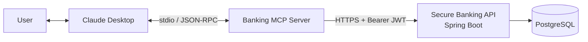

# Banking MCP Server

An [MCP](https://modelcontextprotocol.io) server, written in TypeScript, that lets an AI agent such as
Claude Desktop use the [Secure Banking API](https://github.com/heena5498/secure-banking-application).
The agent can check balances and read transaction history directly, and it can move money only after
the user has confirmed the transfer.

> **Status:** Phase 3 of 7. The three read-only tools work, with retries and agent-friendly error
> handling, and are tested against a mock bank.
> `transfer`, role-based permissions and the eval come in later phases. See the [roadmap](#roadmap).

## Why this project

Connecting an LLM to a bank account raises questions that a plain API wrapper doesn't have to answer:

- **Which actions can the agent take on its own?** Reads are safe. Moving money is not.
- **How does it fail?** If the bank is down, the agent should get an error it can explain or retry,
  and the server shouldn't crash.
- **Who is allowed to do what?** An administrator and a customer should not see the same tools.
- **How do we know it behaves?** "It worked when I tried it" isn't evidence. A repeatable eval is.

This server answers each of these.

## What it does

| Tool | Kind | Role | Confirmation |
|---|---|---|---|
| `list_accounts` | read | `CUSTOMER` | No |
| `get_balance` | read | `CUSTOMER` | No |
| `list_transactions` | read | `CUSTOMER` | No |
| `transfer` | **write** | `CUSTOMER` | **Yes, enforced by the server** |
| `admin_list_accounts` | read | `ADMIN` | No |
| `admin_list_transactions` | read | `ADMIN` | No |

- **Confirmed transfers.** `transfer` works in two steps. The first call only returns a preview and a
  single-use `confirmationId`. Money moves only when the agent calls again with that ID, after the
  user has said yes. The second call must exactly match the preview.
- **Recoverable errors.** Timeouts, network failures and API errors such as `INSUFFICIENT_FUNDS`
  become structured tool errors (`code`, `message`, `retryable`, `hint`) that the agent can act on.
- **Role-based tools.** The `roles` claim in the caller's JWT decides which tools are listed. Every
  call is checked again, so a hidden tool can't be called by name.
- **Eval.** 10–15 test prompts check that the agent picks the right tool and never transfers without
  confirmation.

## Architecture at a glance



The full design is in the docs:

- [Requirements](docs/requirements.md): what the system must do and how each requirement is verified.
- [Architecture / HLD](docs/architecture.md): components, request flows, the transfer confirmation
  protocol, error model and security.

## Tech stack

Node.js 22 · TypeScript · `@modelcontextprotocol/sdk` · `zod` · Vitest · MSW (mock bank API) ·
Anthropic API (eval)

## Roadmap

| Phase | Scope
|---|---|
| 1 | Requirements, architecture, HLD, repo setup
| 2 | TypeScript scaffold, API client, read-only tools
| 3 | Failure handling and error mapping
| 4 | JWT role-based tool permissions
| 5 | `transfer` with server-enforced confirmation
| 6 | Eval suite (10–15 prompts)
| 7 | Claude Desktop setup guide, CI, demo

## Getting started

### Prerequisites

- Node.js 22+
- A running [Secure Banking API](https://github.com/heena5498/secure-banking-application) (Docker +
  Java 25). Not needed for the tests, which use a mock bank.
- Claude Desktop, or any MCP client

### Install, build and test

```bash
npm install
npm run build     # compiles to dist/
npm test          # unit + MCP protocol tests against the mock bank (no API needed)
```

### Configuration

The server reads environment variables (see [.env.example](.env.example)):

| Variable | Required | Description |
|---|---|---|
| `BANK_API_BASE_URL` | yes | e.g. `http://localhost:8080` |
| `BANK_API_TOKEN` | one of | A JWT from `POST /api/auth/login` |
| `BANK_EMAIL` + `BANK_PASSWORD` | one of | The server logs in itself, and logs in again when the token expires |
| `BANK_API_TIMEOUT_MS` | no | Per-attempt timeout. Default `5000` |
| `BANK_API_MAX_RETRIES` | no | Retries for reads after a timeout, network error, 429 or 5xx (0–5). Default `2` |
| `LOG_LEVEL` | no | `debug` \| `info` \| `warn` \| `error` (logs go to stderr) |

### Use with Claude Desktop

Add this to `claude_desktop_config.json` (on macOS: `~/Library/Application Support/Claude/`), then
restart Claude Desktop:

```json
{
  "mcpServers": {
    "banking": {
      "command": "node",
      "args": ["/absolute/path/to/banking-mcp-server/dist/index.js"],
      "env": {
        "BANK_API_BASE_URL": "http://localhost:8080",
        "BANK_EMAIL": "you@example.com",
        "BANK_PASSWORD": "your-password"
      }
    }
  }
}
```

Then ask something like *"What's the balance of my checking account?"*

### Project layout

```
src/
  index.ts            entry point: config → auth → server → stdio
  config.ts           env parsing and validation (zod)
  auth.ts             token from env, or login with automatic re-login
  bank/client.ts      typed API client: timeouts, retries with backoff, cancellation
  bank/types.ts       API DTOs
  errors.ts           ToolError + per-code policy (retryable, hint) for every API error
  format.ts           account-number masking, money formatting
  logger.ts           JSON logs to stderr, with secrets redacted
  server.ts           McpServer setup
  tools/readTools.ts  list_accounts, get_balance, list_transactions
test/
  mockBank.ts         MSW mock of the Secure Banking API
  harness.ts          connects a real MCP client to the server in memory
  readTools.test.ts   tool behaviour
  failures.test.ts    retries, error mapping, cancellation
  units.test.ts       config, formatting, logging
```
