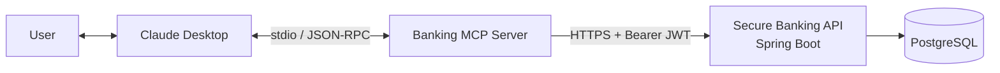

# Banking MCP Server

An [MCP](https://modelcontextprotocol.io) server, written in TypeScript, that lets an AI agent such as
Claude Desktop use the [Secure Banking API](https://github.com/heena5498/secure-banking-application).
The agent can check balances and read transaction history directly, and it can move money only after
the user has confirmed the transfer.

> **Status:** Phase 1 of 7 (design). The design is written down; no server code exists yet. See the
> [roadmap](#roadmap).

## Why this project

Connecting an LLM to a bank account raises questions that a plain API wrapper doesn't have to answer:

- **Which actions can the agent take on its own?** Reads are safe. Moving money is not.
- **How does it fail?** If the bank is down, the agent should get an error it can explain or retry,
  and the server shouldn't crash.
- **Who is allowed to do what?** An administrator and a customer should not see the same tools.
- **How do we know it behaves?** "It worked when I tried it" isn't evidence. A repeatable eval is.

This server answers each of these.

## What it does

| Tool | Kind | Role | Confirmation |
|---|---|---|---|
| `list_accounts` | read | `CUSTOMER` | No |
| `get_balance` | read | `CUSTOMER` | No |
| `list_transactions` | read | `CUSTOMER` | No |
| `transfer` | **write** | `CUSTOMER` | **Yes, enforced by the server** |
| `admin_list_accounts` | read | `ADMIN` | No |
| `admin_list_transactions` | read | `ADMIN` | No |

- **Confirmed transfers.** `transfer` works in two steps. The first call only returns a preview and a
  single-use `confirmationId`. Money moves only when the agent calls again with that ID, after the
  user has said yes. The second call must exactly match the preview.
- **Recoverable errors.** Timeouts, network failures and API errors such as `INSUFFICIENT_FUNDS`
  become structured tool errors (`code`, `message`, `retryable`, `hint`) that the agent can act on.
- **Role-based tools.** The `roles` claim in the caller's JWT decides which tools are listed. Every
  call is checked again, so a hidden tool can't be called by name.
- **Eval.** 10–15 test prompts check that the agent picks the right tool and never transfers without
  confirmation.

## Architecture at a glance

The full design is in the docs:

- [Requirements](docs/requirements.md): what the system must do and how each requirement is verified.
- [Architecture / HLD](docs/architecture.md): components, request flows, the transfer confirmation
  protocol, error model and security.

## Tech stack

Node.js 22 · TypeScript · `@modelcontextprotocol/sdk` · `zod` · Vitest · MSW (mock bank API) ·
Anthropic API (eval)

## Roadmap

| Phase | Scope | Status |
|---|---|---|
| 1 | Requirements, architecture, HLD, repo setup | ✅ Done |
| 2 | TypeScript scaffold, API client, read-only tools | ⏳ Next |
| 3 | Failure handling and error mapping | Planned |
| 4 | JWT role-based tool permissions | Planned |
| 5 | `transfer` with server-enforced confirmation | Planned |
| 6 | Eval suite (10–15 prompts) | Planned |
| 7 | Claude Desktop setup guide, CI, demo | Planned |

## Getting started

Setup instructions will be added in Phase 2, when there is code to run. You will need:

- Node.js 22+
- A running [Secure Banking API](https://github.com/heena5498/secure-banking-application) (Docker +
  Java 25), or the mock API included for tests
- Claude Desktop, or any MCP client
